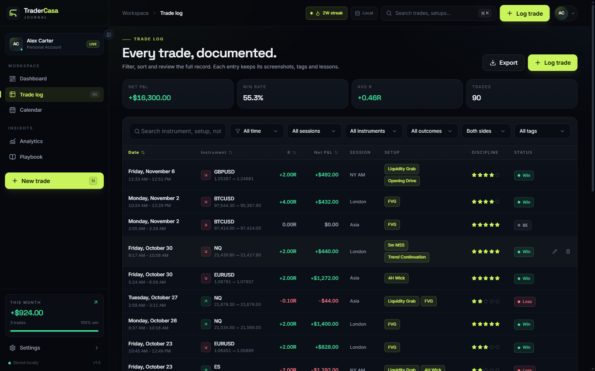
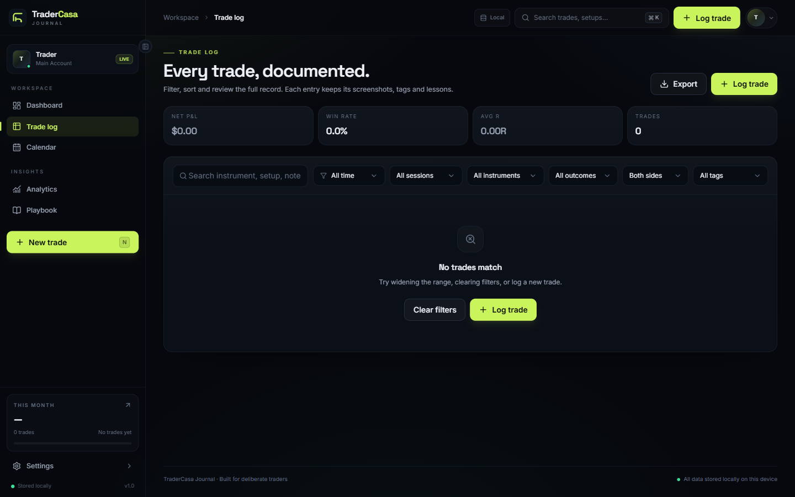

# TraderCasa Journal

A private, local-first trading journal for deliberate traders. Log every trade, measure your execution, and find the leaks in your process — without an account, a cloud, or a subscription.

Everything is stored in your browser's IndexedDB (or in the packaged desktop app), so your journal never leaves your machine.



## Features

- **Dashboard** — equity curve, net P&L, win rate, profit factor, expectancy, average R, max drawdown, streaks, session edge, and execution discipline, all scoped to a selectable range.
- **Trade log** — searchable, filterable, sortable table with pagination. Log entries, stops, targets, size, risk, realized R, session, setup tags, mistakes, a discipline rating, and whether you followed your plan.
- **Chart snapshots** — attach pre-trade and post-trade screenshots. Images are compressed in-browser before being stored alongside the trade.
- **Calendar** — monthly P&L heat map with per-day trade counts and consistency, plus a day drill-down.
- **Analytics** — R distribution, plan-adherence cost, weekday performance, instrument edge, setup edge, the cost of each tagged mistake, and discipline spread.
- **Playbook** — setup notes, a pre-trade checklist, and your non-negotiable rules, alongside per-setup performance so you can see which plays deserve more size.
- **Settings & data** — profile, account balance, default risk, currency, accent theme, week start, storage usage, JSON backup export/import (merge or replace), CSV export, demo data, and a full reset.



## Tech stack

| Layer | Choice |
| --- | --- |
| UI | React 19, TypeScript, Tailwind CSS v4 |
| Routing / state | React Router 7, Zustand |
| Charts | Recharts |
| Forms & validation | React Hook Form, Zod |
| Components | Radix UI primitives, Lucide icons, Sonner toasts |
| Storage | Dexie (IndexedDB) |
| Build | Vite 8, Oxlint |
| Desktop | Electron 45, electron-builder |

## Getting started

**Requirements:** Node.js 20.19+ (or 22.12+) and npm.

```bash
npm install
npm run dev
```

Vite prints the local URL (usually <http://localhost:5173>). The app boots into an empty journal — log a trade, or load the demo journal from **Settings → Demo data** to explore the analytics.

## Scripts

| Command | What it does |
| --- | --- |
| `npm run dev` | Start the Vite dev server |
| `npm run build` | Type-check and build the web bundle into `dist/` |
| `npm run preview` | Serve the production bundle locally |
| `npm run lint` | Run Oxlint |
| `npm run desktop` | Build, then launch the Electron app |
| `npm run desktop:pack` | Build an unpacked Windows app in `release/win-unpacked` |
| `npm run desktop:build` | Build a portable Windows `.exe` into `release/` |

## Desktop app

The Electron shell loads the built bundle over a custom `app://journal` origin instead of `file://`, which gives IndexedDB and `localStorage` a stable origin in production. The renderer runs with `contextIsolation`, no Node integration, and the sandbox enabled; external links open in your default browser.

Packaged builds are written to `release/`, which is git-ignored:

```bash
npm run desktop:build
# → release/TraderCasa-Journal-1.0.0-portable.exe
```

## Your data

- Stored in IndexedDB under the database name `traderscasa-journal`.
- **Settings → Export** writes a versioned JSON backup of your settings and trades.
- **Settings → Import** accepts a backup and can either merge it into your journal or replace everything.
- **Trades → Export CSV** produces a spreadsheet-friendly file of the current log.
- The app makes no network requests for your journal data. Deleting the app's site data (or using **Settings → Reset**) removes it permanently, so keep backups.

## Project structure

```
electron/          Electron main process (app:// protocol, window setup)
build/             App icon used by electron-builder
src/
  components/
    layout/        App shell, sidebar, topbar, command palette
    trades/        Trade form, detail drawer, tag input, image field
    ui/            Reusable UI primitives
  lib/             Dexie database, analytics, backup, seed data, helpers
  pages/           Dashboard, Trades, Calendar, Analytics, Playbook, Settings
  store/           Zustand stores for journal data and UI state
  types/           Trade and settings types
```

## Keyboard shortcuts

| Key | Action |
| --- | --- |
| `Ctrl`/`Cmd` + `K` | Open the search & command palette |
| `N` | Log a new trade |
| `/` | Search the journal |
| `Esc` | Close a dialog or drawer |

## Supported instruments

Futures (NQ, ES, USTEC, CL), forex (EURUSD, GBPUSD), metals (XAUUSD), and crypto (BTCUSD). Each instrument carries its own tick size, point value, and default stop range so risk and R are calculated correctly.

## License

No license has been specified for this repository. All rights reserved by the author unless a license is added.
